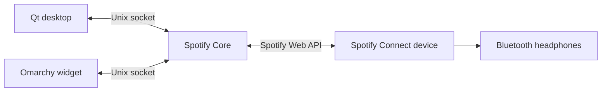

# Omarchy Spotify

Control Spotify Connect from a compact Qt desktop window or an optional Omarchy bar widget. Remote Playback is the default. Start listening on your phone, then use the laptop to pause, resume, seek, switch tracks, or browse and play your library. Use **Devices → Transfer playback here** to move the session explicitly.



## Install and update

Build with Clang, CMake, Ninja, Qt 6.8 or newer, and Python 3.13 or newer.

```sh
cmake -S desktop -B desktop/build -G Ninja -DCMAKE_CXX_COMPILER=clang++ -DCMAKE_BUILD_TYPE=Release
cmake --build desktop/build
python3 -B -m unittest
ctest --test-dir desktop/build --output-on-failure
./install.sh desktop/build --widget
```

Omit `--widget` for desktop-only installation. The installer stages the widget with the application and keeps a backup in the application state directory when migrating a previous plugin checkout. Run the same command after rebuilding to update the components together. Launch **Omarchy Spotify** from the application menu. The desktop works without Omarchy or Quickshell.

`./install.sh --uninstall` removes the installed files registered by the installer. Authorization, application preferences, and the previous widget backup are retained. To roll back, reinstall the previous compatible desktop and widget together, and restore the previous widget directory from its backup if needed.

## Connect Spotify and choose a device

1. Create a Web API application in the [Spotify Developer Dashboard](https://developer.spotify.com/dashboard). Register `http://127.0.0.1:8765/callback`.
2. Save its Client ID in `${XDG_CONFIG_HOME:-~/.config}/omarchy/spotify-client-id`.
3. Select **Connect Spotify** in the desktop library or widget to authorize through the browser. Existing authorization is reused from `${XDG_STATE_HOME:-~/.local/state}/omarchy/spotify/tokens.json`. A session with older scopes may require additional consent.
4. Start playback on the phone. The device name appears in the desktop player and widget. If Spotify has no active device, open **Devices** and explicitly transfer to an available one. A preferred device is marked in the picker when its current details match the saved selection. If its ID changes, select it again.

**Disconnect Spotify** removes the local credentials and clears Core's account caches. The phone's Spotify session continues independently. The Core manages PKCE and token refresh. UI clients receive playback, library and authentication status over IPC.

## Desktop and widget

The desktop supports Liked Songs, saved albums and playlists, lazy scrolling, and Compact Grid by default. Ctrl+1/2/3 switch library sections, Ctrl+G switches album layout, Alt+Left goes back, Space toggles playback, and F11/Esc enter and leave Now Playing within the window.

In the widget, selecting a liked track opens the desktop and plays that track on the active Connect device. Selecting an album or playlist opens its details. **Open track** shows the current track without restarting it. The widget can control playback while the desktop is closed. The existing single-instance desktop launcher handles `--activate`, `--open-track URI`, `--play-track URI`, `--open-album URI`, and `--open-playlist URI`.

**Devices → Local Playback** explicitly enables the optional Soloist adapter for the window. It requires the official `soloist` executable and a personal Soloist key. Select **Remote Playback** to leave Local Mode. The regular installation and remote controls work without Soloist.

## Service and troubleshooting

The app installs a user systemd socket and service. The first connection starts Core through the listening socket inherited from systemd. Closing the window leaves Core available to the widget. If the user systemd manager is unavailable, the UI can start the installed Core as a detached process. The Unix socket is at `$XDG_RUNTIME_DIR/omarchy-spotify/core.sock`. The CLI and Quickshell must resolve the installed tools in `~/.local/bin`.

Use `systemctl --user status omarchy-spotify.socket omarchy-spotify.service` and `journalctl --user-unit omarchy-spotify.service` to diagnose activation. Restart with `systemctl --user restart omarchy-spotify.service`. Clients reconnect and retrieve a fresh snapshot. Spotify Connect playback on the phone continues independently of the Core.

Spotify Premium, granted scopes, app mode, and device capabilities determine available operations. Development Mode playlist contents may be available only for playlists the user owns or collaborates on. The UI can show the collection while reporting unavailable contents. Choosing a row inside a playable album or playlist sends the collection and that row's original offset. A standalone track from Liked Songs uses the single-track playback request. Core honors transient rate limits and suspends automatic API calls when Spotify reports Development Mode quota exhaustion. Restart Core after the quota becomes available to resume synchronization. See [Spotify's migration guide](https://developer.spotify.com/documentation/web-api/tutorials/february-2026-migration-guide) and [quota documentation](https://developer.spotify.com/documentation/web-api/concepts/quota-modes).

## IPC v1

The listening directory and socket are user-only. Each frame is one UTF-8 JSON object followed by LF, up to 256 KiB. Requests contain `version: 1`, a string `id`, `method`, and an object `params`. Responses echo the ID and contain either `ok: true` and `result`, or `ok: false` and `error.code`. Library and authentication results may carry an operation-specific `status`, with `retry` in seconds for transient throttling.

| Methods | Parameters and result |
|---|---|
| `subscribe`, `snapshot` | Empty parameters. Return playback and auth state, snapshot age, account revision, pending action and synchronization status. Subscribe also enables events on the connection. |
| `refresh`, `connect`, `disconnect` | Empty parameters. Ask for playback reconciliation, OAuth PKCE, or clearing local credentials. |
| `devices`, `queue`, `preferDevice` | Read available devices or the queue. Set a preference using the current `deviceId`. |
| `playback.resume`, `pause`, `next`, `previous`, `seek`, `play`, `shuffle`, `repeat`, `volume`, `transfer` | All names use the `playback.` prefix. Use the displayed `deviceId` for target-change detection. Transfer requires an explicit ID. Seek takes `uri` and `position` in ms. Play takes `uri` and optionally `context` and `offset`. Shuffle and repeat take `state`, volume takes `volume`. |
| `library`, `collection` | `args` contains the category or collection URI, then the numeric offset as a string. Response includes `items` and nullable `next`. Clients use this continuation for infinite scrolling. |
| `track`, `episode`, `favorite`, `save`, `remove` | `args` contains a single Spotify item ID. |

Events contain `version`, `event`, `revision`, and `data`. `playback.changed` carries a full snapshot. `library.changed` invalidates affected Liked Songs and favorite state. Reset revision tracking on reconnect and apply the new subscription snapshot. Mutating playback replies use `accepted: true` after Spotify accepts the request. Subsequent playback snapshots reconcile the result. Navigation methods are desktop launcher actions and never transfer or start playback on their own.

Omarchy theme and translation support use the [Omarchy app templates](desktop/TEMPLATE-LICENSE).
